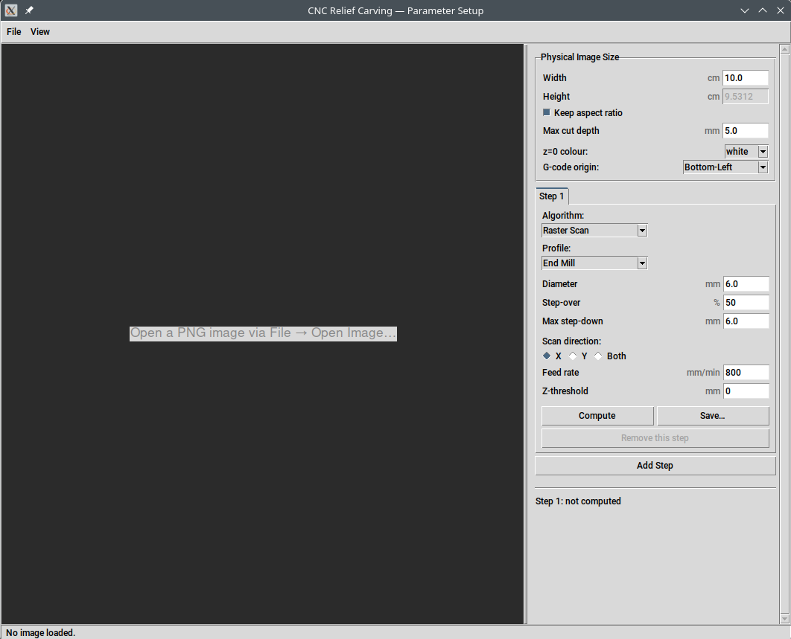

# BM2GCODE

Convert bitmap images into CNC G-code for relief carving. BM2GCODE generates optimized toolpaths from grayscale images using multiple cutting strategies and tool profiles.



## Features

- **Three cutting algorithms**: Raster scan, V-carving, and contour (waterline) strategies
- **Multiple tool profiles**: Ball end mill, flat end mill, and V-bit
- **Multi-pass workflow**: Stack multiple cutting steps with different tools and parameters
- **Interactive preview**: 2D and 3D toolpath visualization before exporting
- **Configurable G-code**: Custom preamble/postamble, safe height, feed rates, and origin

## Installation

### Requirements

- Python 3.8+
- `numpy`
- `scipy`
- `scikit-image`
- `matplotlib`
- `tkinter` (usually included with Python)

### Setup

```bash
git clone https://github.com/wernerkistler-sys/BM2GCODE.git
cd BM2GCODE
pip install numpy scipy scikit-image matplotlib
python bm2gcode.py
```

## Usage

1. **Load an image** — Open a grayscale PNG/JPG. Darker pixels represent greater depth; this can be inverted via the *Polarity* setting.
2. **Set dimensions** — Enter the physical size (width/height in cm) and maximum cutting depth (mm).
3. **Add a step** — Choose an algorithm, tool type, and cutting parameters for each pass.
4. **Compute** — Run the toolpath calculation and inspect the 2D/3D preview.
5. **Export G-code** — Save the result to a `.nc` file for your CNC machine.

Multiple steps can be chained together — for example, a coarse raster pass followed by a fine V-carve pass.

### Algorithms

| Algorithm | Best for |
|---|---|
| **Raster Scan** | General-purpose relief carving with ball or flat end mills |
| **V-Carving** | Fine details that a larger tool cannot reach |
| **Contour** | Smooth, layer-by-layer waterline cuts |

### Display Modes

The canvas can show six views of the current step:

- **Original** — the source image
- **Step Residual** — depth remaining before this step
- **Step Result** — depth achieved by this step
- **Step Path (3D)** — the actual toolpath in 3D
- **Unaccessible** — areas the selected tool cannot reach
- **Processing Mask** — the region being cut

## Machine Settings

Open **File → Settings** to configure:

- Safe Z height (rapid travel height)
- Rapid feed rate
- G-code preamble and postamble

## Sample Images

The `samples/` directory contains example images to try: `dragon.png`, `fish.png`, `flower.png`, `mandelbrot.png`, `rosette.png`.

## Project Structure

```
bm2gcode.py      Entry point
app.py           GUI application (Tkinter)
algorithms.py    Toolpath computation (raster, V-carve, contour)
toolpath.py      ToolPath data structure and G-code export
tool.py          Tool definition (profile, diameter, angle)
constants.py     Defaults and configuration
widgets.py       Reusable UI components
```

## License

[GPL v3](LICENSE) — any distributed modifications must remain open source under the same license.
